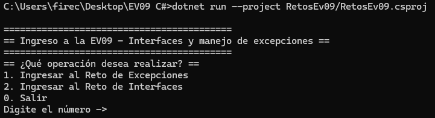
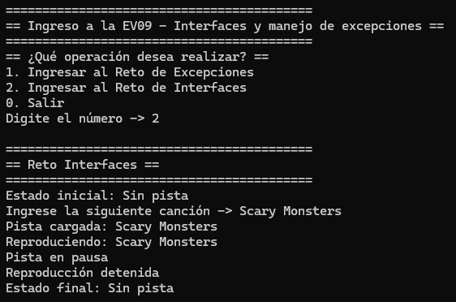
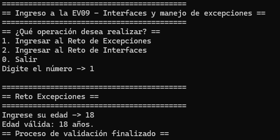

# EV09 - Interfaces y Manejo de Excepciones en C# (.NET)

**Programa:** Tecnólogo en Análisis y Desarrollo de Software (ADSO) - SENA  
**Ficha:** 3412768  
**Evidencia:** `220501097-04-AA1-EV09` - Aplicación de la programación orientada a objetos en C# - Interfaces y manejo de excepciones  

---

## 📋 Descripción del proyecto

Este proyecto de consola reúne en un único menú interactivo la solución a los dos retos prácticos de la guía de aprendizaje:

1. **Reto de Excepciones (`EdadInvalidaException`):** Valida el ingreso de la edad de un usuario (rango permitido entre `0` y `120` años), capturando tanto errores de formato no numérico (`FormatException`) como excepciones personalizadas (`EdadInvalidaException`), garantizando siempre la ejecución del bloque `finally`.
2. **Reto de Interfaces (`IMediaPlayer` y `MusicPlayer`):** Implementa un contrato de reproducción multimedia (`Play()`, `Pause()`, `Stop()` y `GetCurrentTrack()`) junto con el campo privado `current_track` y el método `LoadTrack(string track_name)`.

---




## 🗂️ Estructura del repositorio

```text
EV09_Interfaces_Excepciones/
├── img/
│   ├── 01-menu-principal.png
│   ├── 02-reto-interfaces.png
│   └── 03-reto-excepciones.png
├── RetosEv09/
│   ├── Program.cs
│   └── RetosEv09.csproj
└── README.md